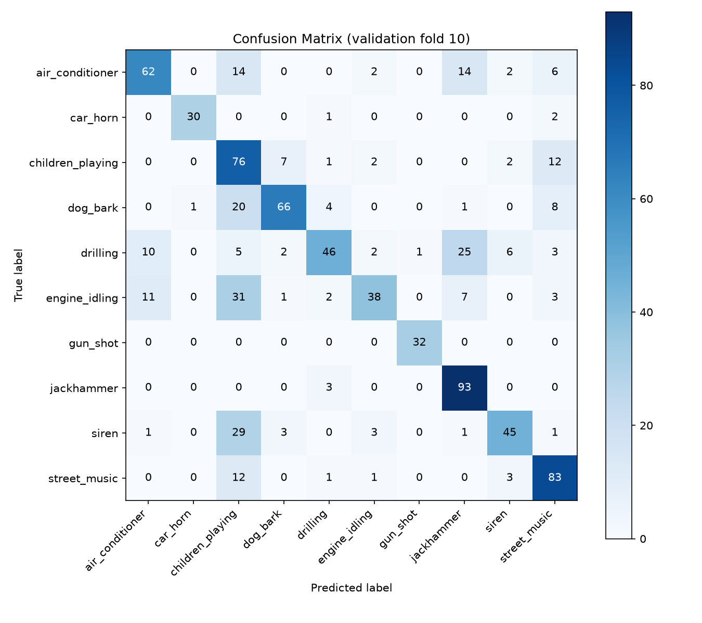
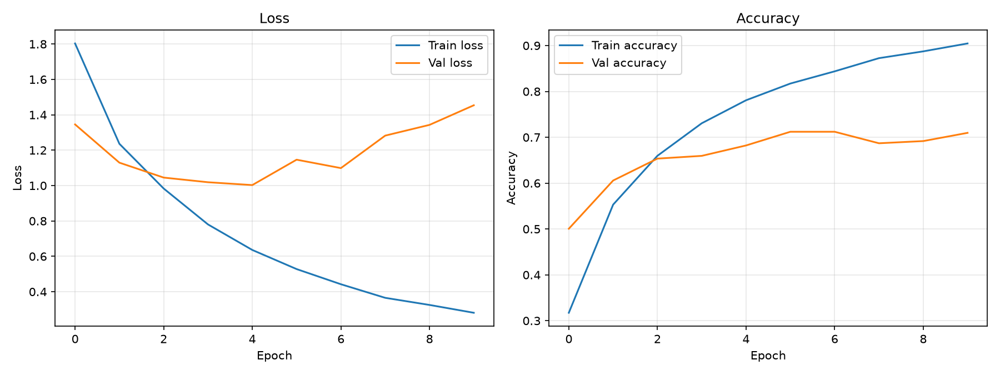

# Audio Noise Classification using CNN

CNN classifier for environmental audio using Mel-spectrogram features on UrbanSound8K.

## Results
- **Validation accuracy: 68.2%** (fold-10 holdout, 10 classes)
- EarlyStopping applied to mitigate overfitting (best epoch: 5)

## Dataset
[UrbanSound8K](https://urbansounddataset.weebly.com/urbansound8k.html) — 8732 labeled urban sound excerpts, 10 classes.

Download separately and place under `./UrbanSound8K/`: